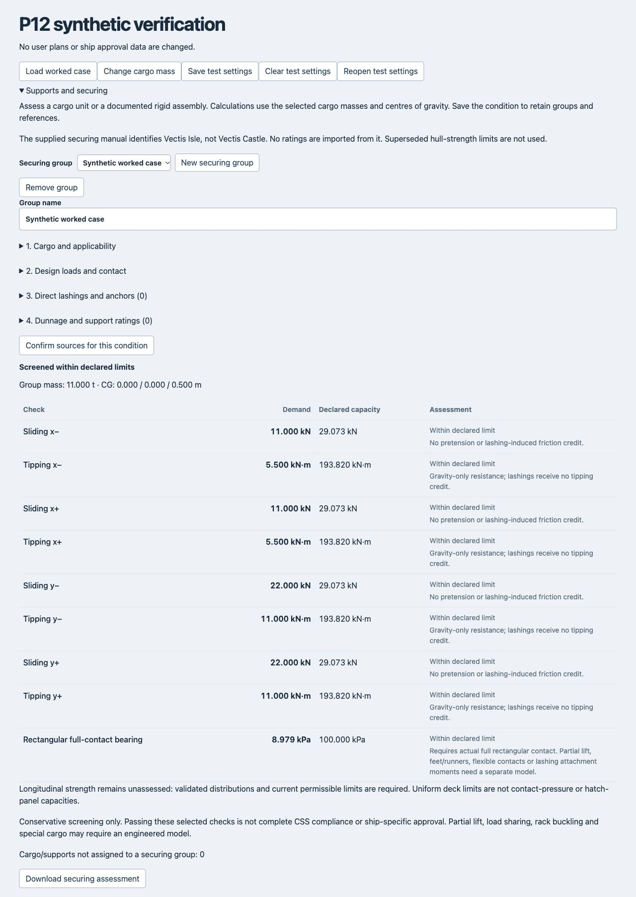

# P12 — Support, local loading and securing assessment

Implemented 2026-10-13. Qualified implementation; not ship-specific securing approval. Existing P05/P06 acceptance and source-data gates remain open.

## Workflow

Open **Loading → Cargo layout → Supports and securing**. Select cargo in the planner before creating a group, or search by name/ID within the group. A group represents one cargo unit or a documented rigid assembly, including selected supports and its internal load path.

The four disclosures cover cargo/applicability, design loads and actual contact, direct lashings/anchors, and support ratings. Inputs intentionally start blank: zero loads, friction and ratings require an explicit basis. Confirm sources for the current condition. Save the condition to preserve settings; the general assessment report includes this section and the panel also exports a standalone JSON assessment. Removing a group has an undo action.

Changes to condition, mass, CG, geometry, surfaces or assessment inputs invalidate the review. Imported verdicts are discarded and recalculated. Manual-condition reports do not present these layout calculations as active-condition results. Calculations run lazily while the panel is open and are memoized; cargo search renders at most 100 rows. Contact-neighbour checks use the existing spatial index.

## Reference applicability

The supplied manual identifies **Vectis Isle / YZJ2011-999**, not Vectis Castle / YZJ2011-1000. No ratings are imported from it. A known mismatch, different vessel or superseded reference disables group calculations; unverified applicability prevents a complete screening result. User declarations remain declarations, not certification. Source evidence is recorded in `docs/vectis-assessment-basis.md` and the P03 source inventory. Existing uniform-load rules remain separate in `docs/cargo-surface-load-checks.md`; superseded bending, shear and torsional limits are not activated.

Method references reviewed: [IMO CSS overview](https://www.imo.org/en/ourwork/safety/pages/css-code.aspx), [CSS 2021 edition](https://imo-epublications.org/content/books/9789280117301), and [MSC.1/Circ.1623 reproduced by ClassNK](https://www.classnk.or.jp/hp/pdf/tech_info/tech_img/T1247e.pdf). This is a restricted conservative independent-axis screen, not the full Annex 13 method or an approved securing computer.

## Numerical scope

- Mass and CG come from actual linked cargo/supports. Design acceleration envelopes and additional wind/sea forces are supplied with their voyage/stowage references; visual motion does not generate forces.
- Minimum normal load is m(9.81 − az). Horizontal demand is m a + additional force. Friction uses the minimum normal load. Each direct lashing uses CS = min(lashing MSL, ship attachment MSL, cargo attachment MSL)/1.5 and its favourable directional component. No pretension, lashing-induced friction bonus or tipping credit is assumed.
- Both signs of each horizontal axis are checked independently. Tipping uses gravity resistance about the declared contact edge and inertial/additional-force moments. These checks do not solve simultaneous mixed-axis load interaction.
- Multiple lashings require a compatible load-sharing/stiffness reference. Missing ratings, repeated anchors or items shared across groups remain unresolved. Ratings are not inferred from material density.
- Full rectangular bearing checks include CG eccentricity and overturning moments, with a no-lift condition. Actual base footprints must cover the declared contact rectangle. Partial contact, feet/runners, gaps and lashing attachment moments require a separate contact model. Hatch panel IDs are identified, but reactions are not invented.
- Pads, braces, racks and beams are distinct. Each selected support conservatively receives the full group load; no equal reaction allocation is assumed. Available checks cover declared system/joint load, average crushing, and a simply supported rectangular beam under a central point load (M = Q L/4; Z = b d²/6; shear = 1.5 Q/(2 b d)). A rack requires an externally justified system rating including buckling.
- Uniform surface limits, contact pressure, hatch-panel capacity and whole-ship strength remain distinct. Validated weight/buoyancy distributions and current permissible limits are still missing for longitudinal strength, which remains **not assessed**.

## Verification

**500 automated tests passed**, including nine P12 cases covering independent calculations, both axes, near-zero friction, weak/missing anchors, ineffective directions, mixed lashings, shared anchors/supports, uplift, eccentricity, missing/deleted/floating cargo, rack/joint overload, crushing/bending/shear, invalid geometry, hatch spanning, source exclusion, persistence and stale-review invalidation. Production build, lint, hosting resource verification and diff whitespace checks passed. The build retains the existing large-chunk advisory.

Browser verification used the real component in the isolated `scripts/p12-browser.html` harness without modifying user plans. A worked 10 t case displayed 26.430 kN sliding capacity, 176.200 kN·m tipping resistance and 8.163 kPa full-contact pressure. Saving, clearing and reopening restored the settings. Increasing mass to 11 t recalculated results and changed the assessment to incomplete pending review. Selecting a superseded reference removed the calculation rows. Screenshot captures the re-reviewed 11 t case.

## Remaining qualifications

No statement here establishes operational CSS compliance. Actual voyage acceleration selection, attachment locations/moments, engineered partial-contact and shared-reaction models, special cargo, rack/member buckling and validated longitudinal strength remain outside this implementation. These are explicit unassessed boundaries rather than automatic passes. P13 may proceed using these qualified assessment outputs; it must not treat an incomplete securing screen as approval.
