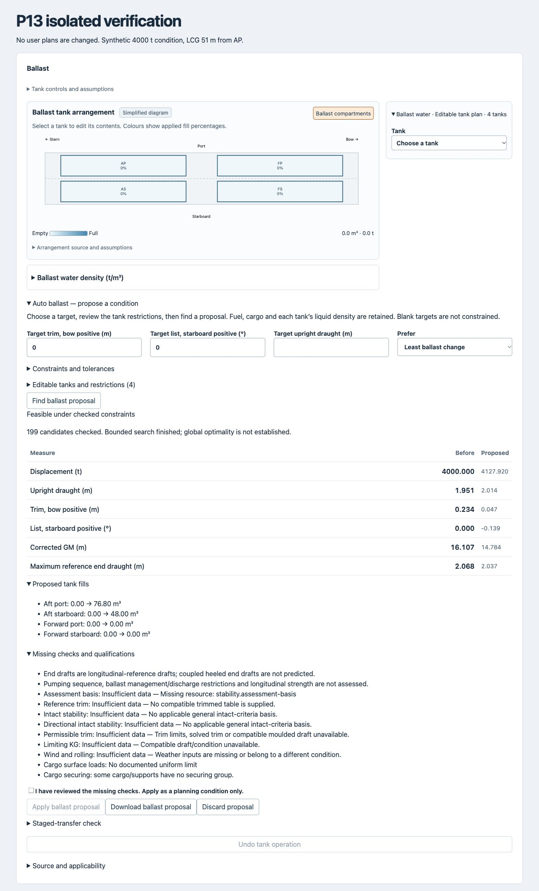

# P13 — Constrained auto ballast

Implemented 2026-10-13 with qualifications. Existing performance/device and vessel-source acceptance gates remain open.

## Operator workflow

Open **Loading → Ballast → Auto ballast — propose a condition**. Manual tank controls remain available. Start an editable tank plan before searching; legacy aggregate ballast masses are not silently replaced. Only existing ballast tank entries participate. Fuel, service liquids, cargo, equipment and surrounding-water density are retained. Each ballast tank retains its own liquid density.

1. Enter target trim (bow positive), list (starboard positive) and/or upright draught. Blank targets are unconstrained. Initial trim/list targets are zero; initial tolerances are 0.05 m / 0.2°. These are editable planning choices, not ship approval limits.
2. Choose least ballast change or least ballast mass. Under Constraints, review tolerances, minimum corrected GM, optional maximum longitudinal-reference end draught and additional displacement limit. The vessel's documented displacement limit also applies at the current surrounding-water density. Minimum GM alone is not an intact-stability assessment. Complete directional intact checks can be required; unavailable checks then prevent acceptance.
3. Review editable tanks, current volumes, liquid densities, capacities, locks and min/max volume restrictions. Use manual controls to change densities. No symmetry of tanks is assumed.
4. Find a proposal. Review before/after mass, draught, trim, list, GM and reference end draught; proposed fills; missing checks and failure reasons. A tolerance-band solution can intentionally stop short of the exact target to reduce ballast/change.
5. Apply only after acknowledging unresolved checks. All fills apply through one existing tank transaction; **Undo tank operation** restores all previous fills together. Applying the proposal uses normal condition persistence. Downloading the proposal includes the input restrictions, numerical results and final assessment evidence.

Changing inputs/condition invalidates results and cancels an in-flight search. Explicit cancellation and unmount abort searches. A stale proposal cannot apply. No partial fills are applied during search.

## Numerical method and boundaries

`src/app/auto-ballast.ts` uses `tankWeight` for every changed volume, including changing tank centres and upright FSM, and the production loading, hydrostatic, trim, GZ/heel and assessment-report engines. Vectis uses trimmed-table balance and available trimmed KM for corrected GM; the pontoon uses its existing linear longitudinal-reference trim method. The latter uses a centreline reference, not a coupled heeled attitude. List uses a resolved stable GZ root, not an invented small-angle fallback. Required metrics outside coverage make a candidate infeasible; tables are not extrapolated.

The search is deterministic and bounded to 240 numerical candidates by default (hard configurable maximum 2,000). For at most three editable variables, a five-level coarse grid precedes refinement. Larger cases use initial/minimum/midpoint/maximum starts. Coordinate refinement steps are 25%, 10%, 2.5% and 0.5% of permitted tank range. Constraint violation ranks ahead of mass/change. Empty/full endpoints are sampled because FSM is discontinuous there. Up to eight ranked finalists are passed through the complete available assessment report; known numerical failures reject them. Missing assessments remain explicit qualifications, including stale condition-specific weather/flooding/securing evidence that cannot simply be carried over to a changed condition.

This is **feasible under checked constraints**, not global optimisation or universal safety. A failed bounded search does not prove mathematical infeasibility. Shared source/results caches are reused, evaluations yield periodically for interaction/cancellation, and the condition key is memoized across progress renders. No physics or 3D mesh simulation is used.

## Transfer and regulatory boundary

Neither supplied tank catalogue defines validated pump connectivity, rates or a transfer sequence. The separate **Staged-transfer check** therefore reports unavailable. No executable pumping instructions, intermediate-stage stability pass, discharge permission or ballast-management compliance is inferred. Current ship-specific procedures would be needed before implementing sequence simulation.

This boundary follows the requirement for a ship-specific ballast water management plan described by [IMO's BWM Convention overview](https://www.imo.org/en/about/conventions/pages/international-convention-for-the-control-and-management-of-ships%27-ballast-water-and-sediments-%28bwm%29.aspx). A numerical final-condition optimisation does not substitute for that plan. Longitudinal strength and unresolved P10–P12 source/model requirements remain qualified.

## Verification

Ten focused automated cases cover:

- Independent small-grid enumeration; mass objective and tolerance boundaries.
- Asymmetric densities; least-change retention; unrelated weights unchanged.
- Empty, full and slack tank FSM through the production interpolation function.
- Locked tanks, restricted capacities, impossible targets and no mutation on failure.
- Out-of-table starts, rejected final assessments and alternate finalists.
- Budget exhaustion, cancellation, nonfinite inputs, duplicate tanks and missing required metrics.
- Draft, displacement and GM constraints; all-tanks-locked cases.
- Production pontoon hydrostatics, sea-density independence and final report generation.
- Vectis reference data through trimmed tables, trimmed GM and full available assessment.

Desktop browser verification used the real TankControls/AutoBallast components in `scripts/p13-browser.html`, with no user storage access. A synthetic 4,000 t pontoon at LCG 51 m from AP produced a proposal after 199 candidate checks: trim 0.234 → 0.047 m, list 0 → −0.139°, ballast 0 → 124.8 m³ / 127.92 t. Both target tolerances were met. Apply updated AP/AS tanks together; Undo restored all tanks to zero. Editing the target hid the stale result and required a new search. Automated tests cover cancellation independent of browser timing.

Final verification: **510 automated tests passed**; production build, lint, hosting resource verification and diff whitespace checks passed. The existing large-chunk build advisory remains. Physical device verification and approved real-ship operation remain outside this acceptance evidence.
