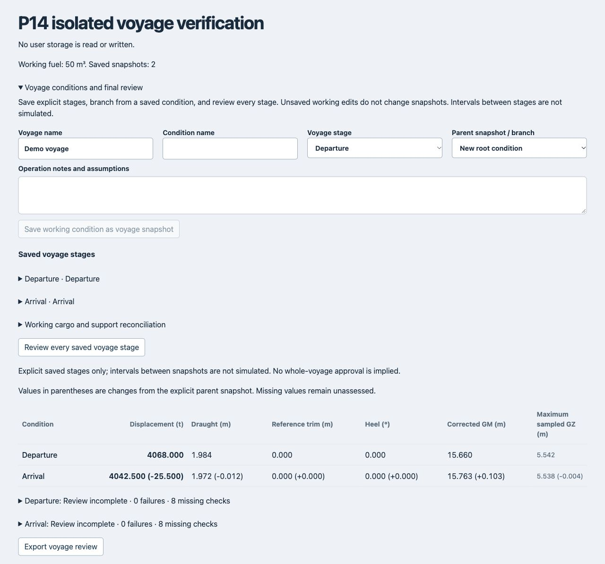

# P14 — Voyage conditions and final review

Implemented 2026-10-14. Workflow implementation is qualified by the existing source/model and P05/P06 acceptance gates; this is not whole-voyage approval.

## Workflow

Open **Save and export → Saved scenarios → Voyage conditions and final review**.

- Name the voyage and condition; choose departure, arrival, intermediate, port loading, port unloading or ballast change. Save the working condition as an explicit immutable snapshot.
- Select a parent snapshot to identify a branch. Load a stage into the normal workplan to edit cargo, equipment or ballast, then save a new branch. Existing snapshots are not overwritten. Undo scenario load restores the previous working condition only while no intervening edits have occurred.
- The derived-branch editor records explicit fuel/service-tank consumption in m³ and whole cargo/support instances to unload. It uses the same tank interpolation and capacity rules as manual controls. Ballast changes remain in the ballast workplan. Supports are not silently removed with cargo; the remaining load path must be reviewed.
- Saving a derived stage does not alter the working condition. Loading it is a separate explicit action. No voyage duration, speed or consumption rate is invented.
- Review every saved stage in the selected voyage, including intermediate stages and alternative branches. The comparison table shows displacement, upright draught, longitudinal-reference trim, resolved heel, corrected GM and maximum sampled GZ, plus differences from each explicit parent. Missing numerical results remain blank.
- Expand each result for numerical failures and missing assessments, including weather, local loading and securing. Export includes snapshots, their relationships, numerical reports and cargo/support reconciliation. The review is invalidated when saved stages change and is cancellable.

## Input and result integrity

`SavedScenario.voyageStage` is optional validated metadata (voyage name, phase, parent ID and notes). Old snapshots remain readable. It is deliberately separate from the existing cargo-plan `voyage` string. Scenario persistence continues through the existing locked read-modify-write library, which retains unreadable sibling records rather than replacing them. Parent removal is detected as a missing relationship; cycles are rejected during review.

Review clones the entire set before asynchronous calculation and uses the production loading, hydrostatic and assessment-report engines. It never mixes working edits with saved-stage calculations. Reports now include upright hydrostatics; models without trimmed tables can report the existing linear longitudinal-reference trim calculation, clearly marked `referenceOnly`. Non-positive corrected GM is a numerical failure even when the ship lacks a documented general intact-criteria basis.

Consumption, cargo changes, equipment/deck changes and reballasting retain assessment input text. Existing condition/layout keys determine whether weather, flooding or securing assumptions still apply. Inputs are not blindly re-confirmed for the new condition. Full numerical report sections are retained in export, including unresolved limits.

## Cargo and support reconciliation

Working and reviewed stages group cargo/support instances by loading area, cargo family/material or name, and cargo/support role. Expandable records retain each ID, mass and CG; changes between snapshots include added, removed and edited instances, so template/property and support-assembly member changes remain traceable without inventing an assembly identity.

Capacity reconciliation reports planned package count, compatible placed count, remaining and excess, other unmatched instances, and placed support mass separately from the support allowance. Compatibility uses selected area, unit mass and dimensions with rotation allowed. It is a geometric/mass match, **not consignment identification or placement approval**. Non-package or incomplete planning inputs leave counts unassessed. Support allowance is a reserve, not a calculated engineering requirement. Actual placement/load-path issues remain in the local-load and securing assessment.

Large instance lists and stage differences are rendered only when their disclosures open. Reviews are explicit, sequential and cancellable, reusing shared calculation resources rather than recalculating every saved stage on each keystroke.

## Verification

Nine focused tests cover:

1. Load/sail/consume/unload snapshots, mass/density updates, unchanged parents and retained source inputs.
2. Invalid consumption or unloading rejected without partial mutation.
3. Metadata roundtrip, legacy compatibility and malformed metadata.
4. Branching, revert guards and template/member property edits.
5. Rotated package matching, remaining/excess counts and separate support mass.
6. Every intermediate stage assessed despite acceptable endpoints.
7. Parent cycles, missing parents and cancellation.
8. Immutable asynchronous snapshots.
9. Production hydrostatic equality and a real negative-GM intermediate condition between acceptable endpoints.

Browser verification used `scripts/p14-browser.html` with in-memory snapshots, without reading or writing user storage. Departure retained 80 m³ of synthetic fuel. An arrival branch consumed 30 m³ and recorded 68 → 42.5 t; working fuel remained 80 m³ until explicitly loading arrival, then became 50 m³. Both stages were reviewed, with displacement 4,068 → 4,042.5 t and the corresponding shared hydrostatic/curve differences. Missing checks were displayed rather than a voyage pass.

Final verification: **519 automated tests passed**, plus production build, lint, hosting resource and diff whitespace checks. Existing chunk-size advisory and physical-device acceptance remain separate. P15 will address the broader portable voyage import/recovery and readable handover workflow; this stage exports review evidence but does not yet provide whole-voyage bundle import. Intervals between snapshots and executable pumping sequences remain unsimulated.
